# 🗺️ Second Brain - Implementation & Remediation Roadmap

This roadmap defines the sequential, batch-by-batch execution plan to eliminate all discovered bugs, complete partial features, install missing test infrastructure, and establish production readiness.

---

## Phased Implementation Sequence

```mermaid
flowchart LR
    subgraph P1["Batch 1: P0 Critical Fixes & Tests"]
        B1_1["TASK-A1: Fix Total Inbox Wipe"]
        B1_2["TASK-A2: Fix Gemini Model ID"]
        B1_3["TASK-A3: Install Vitest & Test Suites"]
    end

    subgraph P2["Batch 2: P1 Reliability & Search"]
        B2_1["TASK-B1: Robust JSON Parser"]
        B2_2["TASK-B2: Optimized Memory Search"]
        B2_3["TASK-B3: Cascade Source References"]
        B2_4["TASK-B4: Fix Vite Dev Proxy"]
    end

    subgraph P3["Batch 3: P2 Performance & Caching"]
        B3_1["TASK-C1: Fast Buffer Base64"]
        B3_2["TASK-C2: Daily Brief Caching"]
        B3_3["TASK-C3: Clean Hardcoded SQL Checks"]
    end

    subgraph P4["Batch 4: P3 Hygiene & Security"]
        B4_1["TASK-D1: Remove Duplicate api/api/"]
        B4_2["TASK-D2: Auth Warnings & Guard"]
        B4_3["TASK-D3: Sync Category Directories"]
    end

    subgraph P5["Batch 5: Final Production Verification"]
        B5_1["Full Test Suite Run"]
        B5_2["Production Web Build"]
        B5_3["Audit Documentation Sync"]
    end

    P1 --> P2
    P2 --> P3
    P3 --> P4
    P4 --> P5
```

---

## Batch Breakdown & Execution Criteria

### Batch 1: Critical Fixes & Test Infrastructure (P0)
- **Objective:** Eliminate catastrophic data loss, fix broken AI model identifier, establish automated regression testing.
- **Tasks Included:**
  - `TASK-A1`: Secure `DELETE /api/sources` against unparameterized total inbox wipes.
  - `TASK-A2`: Update `DEFAULT_GEMINI_MODEL` to `gemini-2.0-flash`.
  - `TASK-A3`: Install `vitest`, create test runner scripts, and build unit tests for Markdown, security, hashing, and category logic.
- **Verification Gate:** `npm test` runs and passes 100%.

### Batch 2: Core Reliability, Parsing & Search (P1)
- **Objective:** Eliminate JSON parse crashes on conversational LLM responses, fix unindexed memory scans, and resolve dangling source pointers.
- **Tasks Included:**
  - `TASK-B1`: Implement resilient regex JSON extraction in `cleanAndParseJson`.
  - `TASK-B2`: Implement SQL-level `searchMemories(query, limit)` and remove destructive query character stripping.
  - `TASK-B3`: Update `deleteKnowledge` to safely archive or update associated sources.
  - `TASK-B4`: Correct Vite proxy target and userscript endpoints from `fitt.workers.dev`.
- **Verification Gate:** Unit tests confirm JSON parsing handles dirty LLM outputs; search tests confirm SQL LIKE queries.

### Batch 3: Performance Optimization & Caching (P2)
- **Objective:** Eliminate base64 string concatenation loops and avoid redundant daily brief LLM execution.
- **Tasks Included:**
  - `TASK-C1`: Replace single-character loop concatenation with `Buffer.from(...).toString('base64')`.
  - `TASK-C2`: Add daily brief caching in D1 `brain_state` table.
  - `TASK-C3`: Clean out hardcoded screenshot string checks from `db/index.ts`.
- **Verification Gate:** Benchmark base64 encoding; verify daily brief returns cached response on subsequent requests.

### Batch 4: Codebase Hygiene & Security Hardening (P3)
- **Objective:** Remove dead duplicate files and tighten client-side credentials.
- **Tasks Included:**
  - `TASK-D1`: Safely delete obsolete directory `api/api/`.
  - `TASK-D2`: Add production security warnings if `AUTH_TOKEN` is unset; restrict default token in production web build.
  - `TASK-D3`: Harmonize `reset-brain-data.mjs` category naming with 19 canonical categories.
- **Verification Gate:** `git status` clean; `npm run typecheck` passes; `npm run build:web` passes.

### Batch 5: Production Readiness Sign-Off
- **Objective:** Run complete verification across all layers and update audit documents.
- **Deliverables:**
  - All test suites passing.
  - Zero high or critical open bugs.
  - Updated health scores and production readiness certificate.
