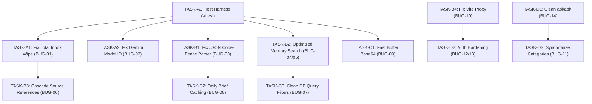

# 📌 Second Brain - Complete Pending Work Inventory

This document defines the prioritized roadmap of actionable engineering tasks required to bring the Second Brain system to production-ready status.

---

## Task Hierarchy & Priority Mapping

- **P0 (Blockers & Critical Fixes):** Data-loss vulnerabilities, broken core AI model references, missing test infrastructure.
- **P1 (High Priority):** LLM JSON parsing resilience, database search efficiency, dangling pointers, API proxy config.
- **P2 (Medium Priority):** Performance bottlenecks (Buffer base64), Daily brief caching, auth hardening, directory cleanup.
- **P3 (Lower Priority & Enhancements):** UI polish, Takeout batch queuing, documentation synchronization.

---

## Category A: Critical Bugs (Must Fix Immediately)

### TASK-A1: Fix Total Database Inbox Wipe on Missing ID (BUG-01)
- **Task ID:** `TASK-A1`
- **Priority:** `P0`
- **Complexity:** `Small`
- **Affected Files:** `api/src/routes/sources.ts`, `api/src/db/index.ts`
- **Description:** Prevent accidental total inbox deletion when `DELETE /api/sources` is invoked without an explicit ID.
- **Why Needed:** Eliminates critical data loss vulnerability where a malformed request drops all sources.
- **Recommended Approach:**
  - In `handleSources`, check if `id === 'all'`. If so, verify a query parameter `?confirm=true` or throw `400 Bad Request`.
  - If `!id`, return `400 Bad Request ("Source ID required for deletion")`.
- **Acceptance Criteria:** `DELETE /api/sources` returns 400. Only explicit `DELETE /api/sources/all?confirm=true` clears sources.

---

### TASK-A2: Correct Gemini Model Configuration (BUG-02)
- **Task ID:** `TASK-A2`
- **Priority:** `P0`
- **Complexity:** `Small`
- **Affected Files:** `api/src/config.ts`
- **Description:** Replace non-existent `gemini-3.8-flash` with official Google Gemini model `gemini-2.0-flash`.
- **Why Needed:** Avoids 404/400 API errors on every Gemini extraction call and stops immediate fallback degradation.
- **Recommended Approach:** Set `DEFAULT_GEMINI_MODEL = 'gemini-2.0-flash'` and `FALLBACK_GEMINI_MODEL = 'gemini-1.5-flash'`.
- **Acceptance Criteria:** Model endpoints query valid Google Gemini API endpoints without HTTP 404.

---

### TASK-A3: Install Vitest & Create Core Test Harness (BUG-15)
- **Task ID:** `TASK-A3`
- **Priority:** `P0`
- **Complexity:** `Medium`
- **Affected Files:** `package.json`, `api/package.json`, `api/tests/`
- **Description:** Introduce an automated testing framework (Vitest) with unit and integration tests.
- **Why Needed:** Establish regression verification across all subsequent refactoring and bug fixes.
- **Recommended Approach:** Install `vitest` in devDependencies; add `npm run test` script to root and `api/`.
- **Acceptance Criteria:** `npm test` executes cleanly and passes all created test suites.

---

## Category B: High-Priority Fixes & Reliability (P1)

### TASK-B1: Robust JSON Extraction & Parsing (BUG-03)
- **Task ID:** `TASK-B1`
- **Priority:** `P1`
- **Complexity:** `Small`
- **Affected Files:** `api/src/ai/gemini.ts`
- **Description:** Replace fragile `.startsWith('```json')` with regex-based substring extraction between outermost `{}` or `[]`.
- **Why Needed:** Prevents JSON syntax errors when LLM outputs preamble or conversational text.
- **Acceptance Criteria:** Handles markdown code fences, leading text, trailing explanation, and nested JSON.

---

### TASK-B2: Optimized SQL-Based Search for Memories (BUG-04 & BUG-05)
- **Task ID:** `TASK-B2`
- **Priority:** `P1`
- **Complexity:** `Medium`
- **Affected Files:** `api/src/db/index.ts`, `api/src/routes/search.ts`
- **Description:** Add `searchMemories(query, limit)` to `Database` class using SQL `LIKE`, and remove over-aggressive search term character stripping.
- **Why Needed:** Eliminates in-memory table scans and memory exhaustion in Cloudflare Workers; restores natural search capability.
- **Acceptance Criteria:** Search queries execute purely in SQLite; supports contractions and longer queries.

---

### TASK-B3: Cascade Handling & Source Cleanup on Knowledge Deletion (BUG-06)
- **Task ID:** `TASK-B3`
- **Priority:** `P1`
- **Complexity:** `Small`
- **Affected Files:** `api/src/db/index.ts`, `api/src/routes/knowledge.ts`
- **Description:** Ensure deleting a knowledge note updates its associated source status and cleans up dangling references.
- **Acceptance Criteria:** Associated sources are cleanly marked `ARCHIVED` or removed without dangling pointers.

---

### TASK-B4: Fix Vite Development Proxy Subdomain (BUG-10)
- **Task ID:** `TASK-B4`
- **Priority:** `P1`
- **Complexity:** `Small`
- **Affected Files:** `web/vite.config.ts`, `scripts/youtube-watcher-userscript.js`
- **Description:** Replace outdated `fitt.workers.dev` with active API worker endpoint or local dev proxy.
- **Acceptance Criteria:** Vite dev proxy correctly routes to active worker or local miniflare server.

---

## Category C: Performance & Scalability (P2)

### TASK-C1: High-Performance Base64 Encoding via Node.js Buffer (BUG-09)
- **Task ID:** `TASK-C1`
- **Priority:** `P2`
- **Complexity:** `Small`
- **Affected Files:** `api/src/services/github-sync.ts`, `api/src/routes/telegram.ts`, `api/src/routes/capture.ts`
- **Description:** Replace single-character loop concatenation with `Buffer.from(...).toString('base64')` or chunked conversion.
- **Why Needed:** Prevents heap thrashing and severe execution slowdown on media or large Markdown files.
- **Acceptance Criteria:** Large files encode in milliseconds without stack overflow.

---

### TASK-C2: Daily Brief Caching in Brain State (BUG-08)
- **Task ID:** `TASK-C2`
- **Priority:** `P2`
- **Complexity:** `Medium`
- **Affected Files:** `api/src/routes/daily-brief.ts`, `api/src/ai/evolution-agent.ts`
- **Description:** Cache today's generated Daily Brief in `brain_state` keyed by date (`daily_brief_YYYY-MM-DD`).
- **Why Needed:** Stops repeated expensive LLM invocations whenever users open the chat or daily brief view.
- **Acceptance Criteria:** Multiple GET requests on the same day return cached brief instantly; POST triggers regeneration.

---

### TASK-C3: Clean Database Query Filters & Remove Hardcoded Strings (BUG-07)
- **Task ID:** `TASK-C3`
- **Priority:** `P2`
- **Complexity:** `Medium`
- **Affected Files:** `api/src/db/index.ts`, `web/src/services/api.ts`
- **Description:** Replace hardcoded SQL filters (`AND title NOT LIKE 'Screenshot_%.png'`) with a clean status-based filter (`status != 'ARCHIVED'`).
- **Why Needed:** Allows legitimate user screenshots to be displayed and indexed properly.
- **Acceptance Criteria:** Legitimate screenshots are visible; legacy bad data is handled via status.

---

## Category D: Hygiene & Security Hardening (P2 / P3)

### TASK-D1: Remove Duplicate Directory `api/api/` (BUG-14)
- **Task ID:** `TASK-D1`
- **Priority:** `P3`
- **Complexity:** `Small`
- **Affected Files:** `api/api/`
- **Description:** Safely remove obsolete nested duplicate directory.
- **Acceptance Criteria:** Directory is deleted; git status is clean.

---

### TASK-D2: Security Hardening & Auth Warnings (BUG-12 & BUG-13)
- **Task ID:** `TASK-D2`
- **Priority:** `P2`
- **Complexity:** `Small`
- **Affected Files:** `api/src/utils/security.ts`, `web/src/services/api.ts`
- **Description:** Add production security warnings when running with unset `AUTH_TOKEN`, and prevent fallback token in production web builds.
- **Acceptance Criteria:** Production environment logs alert if unauthenticated; web client adheres to configured token.

---

### TASK-D3: Vault Directory & Category Synchronization (BUG-11)
- **Task ID:** `TASK-D3`
- **Priority:** `P3`
- **Complexity:** `Small`
- **Affected Files:** `scripts/reset-brain-data.mjs`, `api/src/utils/categories.ts`
- **Description:** Align reset script directory taxonomy with 19 canonical categories.
- **Acceptance Criteria:** All scripts produce synchronized category folders in `vault/01 Knowledge/`.

---

## Implementation Ordering & Dependencies


