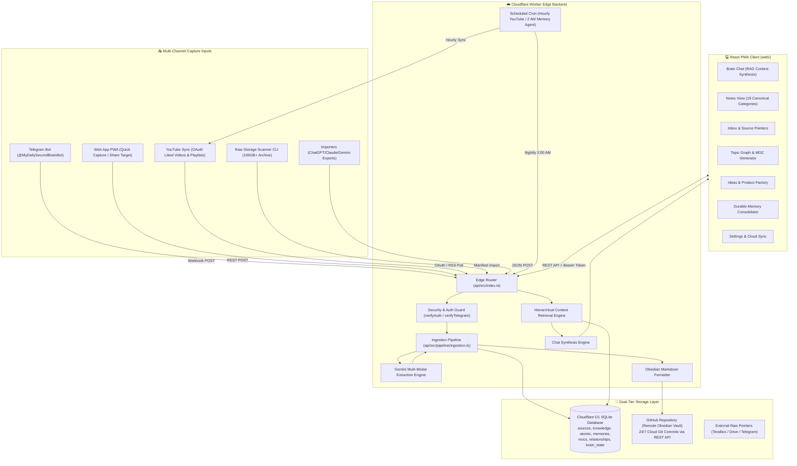

# 🧠 Second Brain - Project Architecture & Technical Overview

## 1. Executive Concept & System Purpose

The **Second Brain Knowledge Engine** is a personal intelligence operating system designed to capture, compress, synthesize, and retrieve knowledge across a user's digital life.

### The Foundational Architecture
Most knowledge management systems fall into one of two traps:
1. **Digital Landfill (Hoarding):** Storing hundreds of gigabytes of raw video files, images, voice recordings, and PDFs inside local folders or database blobs, leading to severe storage bloat, prohibitive cloud database costs, slow search, and inability to run fast AI queries.
2. **Lossy Superficial Bookmarking:** Storing only URLs or title bookmarks without extracting atomic ideas, transcripts, key takeaways, and causal relationships.

The Second Brain solves this by **decoupling raw file storage from compressed knowledge**:
- **Raw Files (M0 Layer):** 100 GB+ media files remain in their native external storage providers (TeraBox, Google Drive, Telegram CDN, YouTube, Discord, or local disk). The system only holds lightweight metadata pointers (`RAW-XXXXXX`).
- **Compressed Structured Knowledge (M1 Layer):** Multi-modal AI (Gemini 2.0 / Flash) extracts structured insights, key facts, takeaways, on-screen text, audio profiles, and full transcripts.
- **Atomic Knowledge (M2 Layer):** High-value insights are atomized into individual concept claims (`CONCEPT`, `FACT`, `CLAIM`, `ACTION`, `INSIGHT`, `USER_THOUGHT`) with confidence scores.
- **Maps of Content (M3 Layer):** Topic-level MOCs synthesize and group related notes across time.
- **Durable Memories (M4 Layer):** Nightly autonomous agents evaluate candidate observations and promote recurring principles, personal preferences, and mental models to durable memory.
- **Obsidian Vault Sync:** All knowledge notes are generated as local-first Obsidian Markdown files with YAML frontmatter, tags, callouts, and bidirectional `[[WikiLinks]]`, committed directly to GitHub via cloud-native worker commits 24/7.

---

## 2. System Architecture & Component Interaction



---

## 3. Technology Stack Breakdown

| Layer | Technology | Version / Configuration | Purpose |
| :--- | :--- | :--- | :--- |
| **Edge Compute** | Cloudflare Workers | Runtime: `workerd`, `nodejs_compat` | Serverless edge execution, zero cold starts, global distribution |
| **Edge Database** | Cloudflare D1 | SQLite (via Miniflare v3 locally) | Relational storage for sources, notes, atomic facts, memories, and graph edges |
| **AI Models** | Google Gemini API | Primary: `gemini-2.0-flash`, Fallback: Multi-AI | Multi-modal reasoning, structured JSON extraction, synthesis |
| **Secondary AI** | xAI Grok, Anthropic Claude, OpenAI | Fallback pipeline | High-availability failover if primary AI quota is exhausted |
| **Frontend Framework** | React 18 + TypeScript | React 18.3.1, TypeScript 5.7.2 | Single-page reactive user interface |
| **Build & Bundler** | Vite | Vite 6.0.7 with `@vitejs/plugin-react` | Ultra-fast client build and PWA packaging |
| **Styling** | Tailwind CSS | Tailwind 3.4.17 + PostCSS | Dark-mode terminal/glassmorphism design system |
| **Icons** | Lucide React | Lucide React 1.16.0 | Modern interface symbology |
| **Mobile Integration**| PWA / Web App Manifest | Service Worker + Android Web Share Target | Native Android/iOS share target integration |
| **Knowledge Storage**| Obsidian Markdown | CommonMark + YAML Frontmatter + WikiLinks | Local-first, portable personal knowledge graph |
| **Cloud Sync** | GitHub REST API | Octokit-compatible Cloud REST sync | Automated 24/7 vault commits without desktop Obsidian app running |

---

## 4. Codebase Organization

```text
secondbrain/
├── api/                             # Cloudflare Worker Backend
│   ├── src/
│   │   ├── index.ts                 # Worker entry point: HTTP fetch router + Scheduled cron handler
│   │   ├── config.ts                # Environment bindings interface & model constants
│   │   ├── types.ts                 # TypeScript domain interfaces (Source, Knowledge, Memory, etc.)
│   │   ├── db/
│   │   │   └── index.ts             # D1 SQLite query repository & data access methods
│   │   ├── ai/
│   │   │   ├── gemini.ts            # Gemini REST client, code-fence cleaner, Multi-AI failover
│   │   │   ├── prompts.ts           # System prompts for extraction, memory consolidation & chat
│   │   │   ├── memory-agent.ts      # Nightly Memory Consolidation Agent (M4 evaluation)
│   │   │   └── evolution-agent.ts   # Nightly Evolution & Discovery Agent (Pattern detection)
│   │   ├── pipeline/
│   │   │   ├── ingestion.ts         # Ingestion controller: deduplication, extraction, persistence
│   │   │   ├── markdown.ts          # Obsidian markdown note & MOC generator
│   │   │   └── retrieval.ts         # Hierarchical RAG context retriever & chat synthesis
│   │   ├── routes/
│   │   │   ├── capture.ts           # POST /api/capture (multi-part, JSON, raw text)
│   │   │   ├── chat.ts              # POST /api/chat (Second brain question answering)
│   │   │   ├── search.ts            # GET /api/search?q= (Full-text knowledge & atomic search)
│   │   │   ├── knowledge.ts         # GET/DELETE /api/knowledge/:id
│   │   │   ├── memories.ts          # GET /api/memories, POST promote/reject/consolidate
│   │   │   ├── sources.ts           # GET/DELETE /api/sources/:id
│   │   │   ├── youtube-sync.ts      # YouTube OAuth, playlist sync, and video ingestion
│   │   │   ├── daily-brief.ts       # GET/POST /api/daily-brief
│   │   │   ├── mocs.ts              # GET/POST /api/mocs (Map of Content generator)
│   │   │   ├── sync.ts              # GET/POST /api/sync (Vault cloud sync to GitHub)
│   │   │   ├── manifest.ts          # POST /api/manifest/import (Batch pointer importer)
│   │   │   ├── importers.ts         # POST /api/import/chat, /api/import/youtube-history
│   │   │   ├── telegram.ts          # POST /api/telegram/webhook (BotFather capture webhook)
│   │   │   ├── extraction.ts        # GET /api/extraction (Status reporting)
│   │   │   └── export.ts            # GET /api/export/vault, /api/export/markdown/:id
│   │   ├── services/
│   │   │   └── github-sync.ts       # Direct Cloudflare Worker -> GitHub REST API committer
│   │   └── utils/
│   │       ├── categories.ts        # 19 canonical category taxonomies & rule resolver
│   │       ├── hash.ts              # Web Crypto SHA-256 deduplication hasher
│   │       ├── response.ts          # Standardized JSON/CORS response helpers
│   │       └── security.ts          # Prompt injection sanitizer & token verifiers
│   ├── schema.sql                   # SQLite schema for Cloudflare D1
│   ├── tsconfig.json                # API TypeScript configuration
│   └── wrangler.toml                # Worker configuration, bindings, cron triggers
│
├── web/                             # React + Vite PWA Frontend
│   ├── src/
│   │   ├── main.tsx                 # React DOM root entry
│   │   ├── App.tsx                  # Master application shell, tab router, auto-sync
│   │   ├── index.css                # Tailwind styling & dark theme tokens
│   │   ├── types/index.ts           # Shared frontend TypeScript interfaces
│   │   ├── components/
│   │   │   ├── Navbar.tsx           # Primary top/bottom navigation bar & status indicators
│   │   │   ├── CaptureModal.tsx     # Quick capture dialog (camera, audio recording, URL, text)
│   │   │   ├── KnowledgeCard.tsx    # Expandable knowledge card with copy, delete, badges
│   │   │   └── ErrorBoundary.tsx    # React error boundary component
│   │   ├── pages/
│   │   │   ├── BrainChat.tsx        # Conversational RAG interface with source provenance
│   │   │   ├── KnowledgeView.tsx    # Filterable knowledge note catalog (grid/list)
│   │   │   ├── Inbox.tsx            # Raw source capture queue & processing statuses
│   │   │   ├── TopicsGraph.tsx      # Discovered topics list & MOC generator
│   │   │   ├── IdeasFactory.tsx     # Product & SaaS opportunity generator
│   │   │   ├── MemoriesView.tsx     # M4 Durable memory review & manual consolidation
│   │   │   ├── SourcesView.tsx      # Raw file storage catalog & manifest importer
│   │   │   └── Settings.tsx         # API URL, auth token, YouTube OAuth & GitHub sync
│   │   ├── services/
│   │   │   └── api.ts               # Typed frontend HTTP client
│   │   └── utils/
│   │       ├── categories.ts        # Canonical category definitions & note categorizer
│   │       └── media.ts             # Image compression, camera stream, audio recorder, keyframes
│   ├── public/                      # Static assets, Web App Manifest, icons
│   ├── vite.config.ts               # Vite build config & local API proxy
│   └── tsconfig.json                # Web TypeScript configuration
│
├── scripts/                         # Operational CLI Utilities
│   ├── seed-demo.mjs                # Seeds D1 database and starter Obsidian notes
│   ├── seed.sql                     # SQL seed dataset
│   ├── reset-brain-data.mjs         # Wipes and re-initializes clean vault directories
│   ├── sync-vault.mjs               # Pulls entire cloud vault notes to local disk
│   ├── sync-youtube.mjs             # CLI trigger for YouTube sync
│   ├── scan-raw-storage.mjs         # Scans local 100GB+ drive and uploads pointer manifest
│   ├── push-to-remote-d1.mjs        # Syncs local D1 database records to Cloudflare remote
│   └── youtube-watcher-userscript.js# Tampermonkey userscript for auto-capturing watched videos
│
├── vault/                           # Local Obsidian Markdown Vault
│   ├── 00 Inbox/                    # Temporary raw notes
│   ├── 01 Knowledge/                # Extracted categorized knowledge notes
│   ├── 02 Topics/                   # High-level Maps of Content (MOCs)
│   ├── 03 Projects/                 # Active projects
│   ├── 04 People/                   # People & collaborator notes
│   ├── 05 Resources/                # Reference material
│   ├── 06 Memories/                 # Durable memories, Daily Briefs & Current Context
│   ├── 07 Ideas/                    # Content & Product opportunities
│   ├── 08 Decisions/                # Logged architectural & strategic decisions
│   ├── 09 Sources/                  # Raw file pointers
│   └── 99 System/                   # System architecture documentation
│
└── package.json                     # Monorepo management scripts
```
